# TOTEM keymap

A ZMK config for the [TOTEM](https://github.com/GEIGEIGEIST/TOTEM) (38 keys,
3x5+3 with two extra outer keys) running on two Seeed XIAO nRF52840 halves.

This keymap is a deliberate port of a Corne-ish Zen layout (42 keys, 3x6+3).
The priority was a painless transition: Corne positions are preserved wherever
the hardware allows, and only the keys that physically have nowhere to go were
moved. On top of that it adds a few things aimed at TypeScript/Kotlin work and
vim.



The image above is re-rendered by CI on every keymap change. Keep it open on a
second screen during the first week.

---

## Contents

1. [Coming from a Corne](#coming-from-a-corne)
2. [Layers](#layers)
3. [Combos](#combos)
4. [Macros](#macros)
5. [macOS and Linux](#macos-and-linux)
6. [Tuning reference](#tuning-reference)
7. [ZMK options reference](#zmk-options-reference)
8. [Building and flashing](#building-and-flashing)
9. [Transition guide](#transition-guide)

---

## Coming from a Corne

The Corne has six columns per hand. The TOTEM has five, plus a single extra
outer key on the bottom row of each hand. That means four keys from the Corne's
outer columns have no home and had to move.

| Key | On the Corne | On the TOTEM | Why |
| --- | --- | --- | --- |
| `TAB` | Top left outer | `Q`+`W` combo | No top-row outer key exists |
| `LSHIFT` | Bottom left outer | Hold the left outer key | **Same spot as the Corne** |
| `LCTRL` | Left home outer | Hold the right outer key | No home-row outer key exists |
| `BSPC` | Top right outer | Tap the right outer key | No top-row outer key exists |
| `SQT` (`'`) | Right home outer | `L`+`;` combo, or `C` position on SYMBOL | No home-row outer key exists |
| `ESC` | Bottom right outer | Tap the left outer key, or `J`+`K` | Swapped sides with `BSPC` |
| `PG_DN` | NUMBER, right of `PG_UP` | NUMBER, right outer key (under `PG_UP`) | Only five columns |
| `GRAVE` | NUMBER, top left outer | SYMBOL, `A` position | No top-row outer key exists |
| `F11` / `F12` | NUMBER, bottom row | FN, `K` / `L` positions | Only five columns |
| `BOOT` / `RST` (right half) | FN, `H` / `G` positions | FN, right outer column (`;` / `/` positions) | Each half needs its own |

Dropped entirely: RGB underglow, external power and the display widgets (the
TOTEM has no LEDs or screen), and the unused `td0` tap-dance.

Everything else is where you left it. All thirty alphas, the punctuation on the
bottom row, and the entire thumb cluster are unchanged:

```
GUI   NUM   SPC   |   ENT   SYM   ALT
```

Layer numbers are also unchanged, so `NUM` is still layer 1 and `SYM` is still
layer 2, and holding both still gets you to the function layer.

### Why SHIFT stayed left and CTRL went right

Only one of the two could keep a left-hand key. Shift won because the TOTEM's
bottom-left outer key is *exactly* where the Corne's left Shift was, so the
strongest pinky habit carries over untouched, and right-hand capitals (`J`,
`K`, `?`, `:`) still get the opposite-hand Shift.

Ctrl moving right is cheap on macOS, where the same-hand chords (`Cmd+C`,
`Cmd+V`, `Cmd+Z`...) live on the left thumb. On Linux the LINUX overlay moves
Ctrl onto that same left thumb, so `Ctrl+C`/`V`/`Z` stay one-handed there too.

### What is deliberately *not* here

There are no home-row mods. This layout keeps modifiers on dedicated keys
exactly like the Corne did, because learning a new physical board and a new
modifier system at the same time is two adaptations too many. See
[Adding home-row mods later](#adding-home-row-mods-later) once the board feels
natural.

---

## Layers

Key positions, as used by combos and by any `hold-trigger-key-positions` you
might add later:

```
     0  1  2  3  4        5  6  7  8  9
    10 11 12 13 14       15 16 17 18 19
 20 21 22 23 24 25    26 27 28 29 30 31
       32 33 34        35 36 37
```

In the diagrams below, `--` is a transparent key (it falls through to the layer
underneath) and `XX` is an intentionally dead key.

### Layer 0 -- BASE (macOS)

```
           Q     W     E     R     T   |   Y     U     I     O     P
           A     S     D     F     G   |   H     J     K     L     ;
SFT/ESC    Z     X     C     V     B   |   N     M     ,     .     /    CTL/BSP
                     GUI   NUM   SPC   |  ENT   SYM   ALT
```

The two outer keys are dual-function: tap for `ESC` / `BSPC`, hold for `SHIFT` /
`CTRL`. Holding `BSPC` gives Ctrl, not repeat: to auto-repeat, tap then hold
within 175ms (`quick-tap-ms`). For bulk deletes use `DELW` / `DELL` on NUMBER. Both thumb inner keys are layer-taps, so `SPACE` and `ENTER` also reach
the FN layer when held.

### Layer 1 -- NUMBER (hold left thumb)

```
           1     2     3     4     5   |   6     7     8     9     0
         SHFT  ()=>   APP  DELW  DELL  |  LFT   DWN    UP   RGT   PGUP
  --      F1    F2    F3    F4    F5   |  F6    F7    F8    F9   F10    PGDN
                      --    --    --   |  --    --    --
```

Arrows sit on `HJKL`, which is already the vim layout. `APP` is the macOS
"cycle windows within the current app" shortcut. `DELW` and `DELL` are
delete-word and delete-to-line-start.

`F11` and `F12` live on the FN layer rather than here, because there are only
five columns. `PGDN` takes the right outer key, directly under `PGUP` -- the one
exception to the transparency convention, so right Ctrl is not available while
NUMBER is held (left Shift still is).

### Layer 2 -- SYMBOL (hold right thumb)

```
           !     @     #     $     %   |   ^     &     *     (     )
           `   BACK   FWD  PLAY  VOL+  |   -     =     [     ]     \
  --       ~     :     '   MUTE  VOL-  |   _     +     {     }     |      --
                      --    --   SPC   |  ENT    --    --
```

The dedicated `:` is there because Shift is now on the right pinky and so is
`;`, which would otherwise make `:` an awkward same-finger chord -- and `:` is
constant in both vim and TypeScript/Kotlin type annotations. The `'` is a
backup for the `L`+`;` combo, in case `null;` style rolls make the combo
unreliable.

### Layer 3 -- FN (hold either thumb outer, or NUM + SYM together)

```
          BT0   BT1   BT2   BT3   BT4  |  ->    ?.    ?:    ::   PSCR
          USB   BLE  BCLR  BCLA  BOOT  |  ===   !==   F11   F12  BOOT
  --      RST   XX    XX    XX   LNX   |  XX    XX    XX    XX   RST      --
                      --    --    --   |  --    --    --
```

`BT0`-`BT4` select an absolute Bluetooth profile. `BCLR` clears the current
profile, `BCLA` clears all of them. `BOOT` enters the bootloader, `RST` resets. Both act on the half they are
pressed on, so each half has its own pair.
`LNX` toggles the Linux overlay.

### Layer 4 -- LINUX (toggled by `LNX` on the FN layer)

```
           --    --    --    --    --  |  --    --    --    --    --
           --    --    --    --    --  |  --    --    --    --    --
  --       --    --    --    --    --  |  --    --    --    --    --   GUI/BSP
                     CTRL   --    --   |  --    --    --
```

### Layer 5 -- LINUX_NUM (automatic, when LINUX and NUMBER are both active)

```
           --    --    --    --    --  |  --    --    --    --    --
           --    --  A-TAB C-BSPC C-U  |  --    --    --    --    --
  --       --    --    --    --    --  |  --    --    --    --    --      --
                      --    --    --   |  --    --    --
```

---

## Combos

All combos are restricted to the base layer, so they cannot fire while you are
holding a symbol or number layer.

| Press together | Positions | Produces |
| --- | --- | --- |
| `Q` + `W` | 0, 1 | `TAB` |
| `L` + `;` | 18, 19 | `'` |
| `,` + `.` | 28, 29 | `DEL` |
| `Z` + `X` | 21, 22 | Caps Word |
| `J` + `K` | 16, 17 | `ESC` |

**Caps Word** capitalises until you type a character that ends a word, then
releases itself. Underscore, backspace and delete do not end it, so it types a
whole `SCREAMING_SNAKE_CASE` constant in one go. This is usually better than a
caps-lock key you have to remember to turn off.

**The `J`+`K` ESC combo** is a second path to Escape for vim. It carries a real
hazard: in normal mode you drum `j` and `k` for line motion, and a fast `jkjk`
run can fall inside the combo window. Two things guard against that -- a tight
30ms window, and `require-prior-idle-ms`, which refuses to even consider the
combo if you typed anything in the previous 150ms. If it still misfires, delete
the `combo_esc` block; `ESC` remains on the left outer key regardless.

---

## Macros

All on the layer shown. These are plain text expansions, so they are correct in
any editor and any mode -- unlike editor command macros, which fire in the wrong
mode eventually.

| Macro | Output | Layer | Use |
| --- | --- | --- | --- |
| `()=>` | `()=>` | NUMBER | TypeScript arrow function |
| `->` | `->` | FN | Kotlin lambda / return type |
| `?.` | `?.` | FN | Safe call, both languages |
| `?:` | `?:` | FN | Kotlin elvis operator |
| `::` | `::` | FN | Method reference / qualified name |
| `===` | `===` | FN | TypeScript strict equality |
| `!==` | `!==` | FN | TypeScript strict inequality |

`!!` and `??` are deliberately absent -- they are two identical keypresses, so a
macro saves nothing.

---

## macOS and Linux

The base layer is macOS, since this is the travel board. Press `LNX` on the FN
layer to toggle the Linux overlay; press it again to go back. The toggle is
**not** saved: after the board resets or the battery dies it comes back up on
macOS, so press `LNX` again.

Six bindings change:

| Key | macOS | Linux |
| --- | --- | --- |
| Right outer (hold) | `CTRL` | `GUI` |
| Left thumb | `GUI` | `CTRL` |
| NUMBER, `D` position | App window cycle `Cmd+\`` | `Alt+Tab` |
| NUMBER, `F` position | Delete word `Alt+Bksp` | `Ctrl+Bksp` |
| NUMBER, `G` position | Delete line `Cmd+Bksp` | `Ctrl+U` |

The first two are the important ones: swapping GUI and CTRL is what makes
`Ctrl+C`, `Ctrl+V` and `Ctrl+Z` work natively on Linux.

> **Caveat on `Ctrl+U`.** That is readline and terminal line-kill. It works in
> shells, in most terminal programs and in readline-based REPLs. It does *not*
> reliably delete a line in GTK or Qt text fields. There is no single Linux
> binding equivalent to macOS `Cmd+Backspace`.

### Why there are two Linux layers

ZMK resolves the highest active layer first. The `LINUX` overlay is layer 4,
which sits *above* `NUMBER` (layer 1). If layer 4 tried to patch a NUMBER key
directly it would also override that position on the base layer, so holding
nothing would give you the wrong letter.

`LINUX_NUM` (layer 5) solves this. A conditional layer activates it only when
layers 1 and 4 are both live, so it can patch NUMBER without touching BASE:

```dts
linux_number {
    if-layers = <NUMBER LINUX>;
    then-layer = <LINUX_NUM>;
};
```

### The transparency convention

Positions 20 and 31 (the outer keys) and position 32 (the left inner thumb) are
`&trans` on every non-base layer (the single exception is `PGDN` at 31 on
NUMBER, which `LINUX_NUM` repeats, because a `&trans` there would fall through
to LINUX's `GUI/BSP` before reaching NUMBER). This is what keeps Ctrl and Shift usable while
a layer is held, and it is also what stops the LINUX overlay from shadowing the
layers underneath it. **If you edit a layer, keep those three positions
transparent.**

### There is no display

Unlike the Corne, this board has no screen and no LEDs, so nothing tells you
which Bluetooth profile is live or whether the Linux overlay is on. Two habits
follow from that:

- Always select an **absolute** profile (`BT0`-`BT4`) rather than cycling.
- If the keyboard behaves strangely, press `LNX` and see if it gets better.

Battery level is reported to the host, so both halves appear in the macOS
Bluetooth menu and in Linux's upower / GNOME status.

---

## Tuning reference

Everything in this section is editable in `config/totem.keymap`.

### Hold-tap

The two outer keys use a custom hold-tap called `bhm`:

```dts
bhm: balanced_hold_tap {
    compatible = "zmk,behavior-hold-tap";
    #binding-cells = <2>;
    flavor = "balanced";
    tapping-term-ms = <200>;
    quick-tap-ms = <175>;
    bindings = <&kp>, <&kp>;
};
```

**Flavors** decide what happens when you press another key while the hold-tap is
down:

| Flavor | Behaviour |
| --- | --- |
| `hold-preferred` | Hold fires as soon as any other key goes down. ZMK's default for `&mt`. |
| `balanced` | Hold fires when the term expires, or when an interrupting key is pressed **and** released. |
| `tap-preferred` | Only the timer produces a hold; other keypresses are ignored. |
| `tap-unless-interrupted` | Inverted -- hold only if another key is pressed before the term expires. |

This config uses `balanced`. `hold-preferred` turns a fast `esc` into a stray
Ctrl, and `tap-preferred` would force you to wait the full 200ms before `Ctrl+C`
registers. `balanced` gives a responsive Ctrl and a reliable tap.

**Properties:**

- `tapping-term-ms` (200) -- how long to hold before the hold behaviour is
  certain. Lower it if Ctrl feels sluggish; raise it if you get stray modifiers.
- `quick-tap-ms` (175) -- re-pressing within this window forces a tap, so
  `esc esc` never becomes a modifier. ZMK measures press-to-press here, unlike
  QMK's release-to-press, so this value is intentionally generous.
- `require-prior-idle-ms` -- not used on `bhm`, but essential if you ever move
  mods onto the home row.
- `hold-trigger-key-positions` -- restrict the hold to happen only when a key
  from this list is pressed. Usually the opposite hand's positions. Again, only
  relevant for home-row mods.

> A note if you go editing: do not copy the `&mt` definition verbatim into this
> file. Doing so overwrites ZMK's built-in behavior everywhere. Define a new
> node with a new label, which is why `bhm` exists.

### Combos

```dts
combo_esc {
    timeout-ms = <30>;
    require-prior-idle-ms = <150>;
    key-positions = <16 17>;
    bindings = <&kp ESC>;
    layers = <BASE>;
};
```

- `timeout-ms` (default 50) -- all listed keys must go down within this window.
  Lower is fewer accidental triggers and more missed ones. Note the name: it is
  `timeout-ms`, not `combo-term-ms`.
- `require-prior-idle-ms` (default -1, disabled) -- ignore the combo if a
  non-modifier key was pressed this recently. The main defence against
  roll-triggered misfires while typing fast.
- `key-positions` -- indices from the position map above.
- `layers` -- omit to allow all layers. Every combo here is scoped to `BASE`.
- `slow-release` -- hold the combo's output until every key is released.

Global: `CONFIG_ZMK_COMBO_MAX_PRESSED_COMBOS` (default 4) caps how many combos
can be active simultaneously.

---

## ZMK options reference

These go in `config/totem.conf`. The ones this config sets are marked.

### Power and sleep

| Option | Default | Notes |
| --- | --- | --- |
| `CONFIG_ZMK_IDLE_TIMEOUT` | `30000` | ms before entering idle (disconnects nothing, just dims activity). |
| `CONFIG_ZMK_SLEEP` | `y` | Enables deep sleep. |
| `CONFIG_ZMK_IDLE_SLEEP_TIMEOUT` | `900000` | **Set to `3600000` here** (1 hour), matching the Corne. Deep sleep cuts the radio, so waking takes a second or two -- a longer timeout trades battery for never waiting. |
| `CONFIG_ZMK_PM_SOFT_OFF` | - | Hardware soft-off, needs a dedicated key or reset pin. |

### Battery

| Option | Notes |
| --- | --- |
| `CONFIG_ZMK_BATTERY_REPORTING` | **Set `y`.** Reports level to the host. |
| `CONFIG_ZMK_BATTERY_REPORT_INTERVAL` | Seconds between reports, default `60`. |
| `CONFIG_ZMK_SPLIT_BLE_CENTRAL_BATTERY_LEVEL_FETCHING` | **Set `y`.** Central asks the peripheral for its level. |
| `CONFIG_ZMK_SPLIT_BLE_CENTRAL_BATTERY_LEVEL_PROXY` | **Set `y`.** Central forwards that level to the host. |

No devicetree work is needed. The XIAO BLE board definition in ZMK already
declares the voltage divider and the `zmk,battery` chosen node:

```dts
chosen { zmk,battery = &vbatt; };

vbatt: vbatt {
    compatible = "zmk,battery-voltage-divider";
    io-channels = <&adc 7>;
    power-gpios = <&gpio0 14 (GPIO_OPEN_DRAIN | GPIO_ACTIVE_LOW)>;
    output-ohms = <510000>;
    full-ohms = <(1000000 + 510000)>;
};
```

If the reported percentage tops out slightly below 100, that is resistor
tolerance on the divider, and you can correct it by overriding `output-ohms`
and `full-ohms` in a local overlay.

### Bluetooth and output

| Option | Notes |
| --- | --- |
| `CONFIG_BT_CTLR_TX_PWR_PLUS_8` | Maximum transmit power. Better range, worse battery. |
| `CONFIG_ZMK_BLE_EXPERIMENTAL_CONN` | Tweaked connection parameters, generally lower latency. |
| `CONFIG_BT_MAX_CONN` / `CONFIG_BT_MAX_PAIRED` | Profile count, default 5. |
| `CONFIG_ZMK_BLE_PASSKEY_ENTRY` | Requires typing a passkey to pair. |

`&out OUT_USB` and `&out OUT_BLE` on the FN layer force the output; `OUT_TOG`
alternates. Useful when a host is connected over both at once.

### ZMK Studio

| Option | Notes |
| --- | --- |
| `CONFIG_ZMK_STUDIO` | **Set `y`.** Enables live keymap editing. |
| `CONFIG_ZMK_STUDIO_LOCKING` | **Set `n`.** No unlock key needed. Convenient; also means anyone with physical access and a cable can rewrite the keymap. Set it to `y` if that matters to you. |

Reserved layers (`extra1 { status = "reserved"; }`) exist so Studio has an empty
slot to work with. Add more if you want room to experiment.

### Split

| Option | Notes |
| --- | --- |
| `CONFIG_ZMK_SPLIT` | Set by the shield. |
| `CONFIG_ZMK_SPLIT_ROLE_CENTRAL` | Left half, set by the shield. |
| `CONFIG_ZMK_SPLIT_BLE_PERIPHERAL_STACK_SIZE` | Raise if the peripheral half is unstable. |

### Behavior defaults

| Option | Default | Notes |
| --- | --- | --- |
| `CONFIG_ZMK_COMBO_MAX_PRESSED_COMBOS` | 4 | Simultaneously active combos. |
| `CONFIG_ZMK_MACRO_DEFAULT_WAIT_MS` | 15 | Delay between macro steps. |
| `CONFIG_ZMK_MACRO_DEFAULT_TAP_MS` | 5 | Tap duration inside a macro. |

Raise the macro values if an application drops characters from `===` or `!==`.

### Debugging

`CONFIG_ZMK_USB_LOGGING=y` turns the left half into a USB serial device that
logs what the firmware is doing. It is commented out in
`config/boards/shields/totem/totem.conf`. Leave it off in normal use -- it costs
battery and conflicts with the Studio snippet on the same UART.

---

## Building and flashing

Firmware builds in GitHub Actions on every push. `build.yaml` defines the
targets:

```yaml
include:
  - board: xiao_ble//zmk
    shield: totem_left
    snippet: studio-rpc-usb-uart
  - board: xiao_ble//zmk
    shield: totem_right
```

The `studio-rpc-usb-uart` snippet is only on the left half, because the left is
the central and that is the half Studio talks to.

To flash:

1. Download the artifact zip from the Actions run.
2. Double-tap the XIAO's reset button. It mounts as a USB drive.
3. Copy the matching `.uf2` onto it. The drive unmounts and the half reboots.
4. Repeat for the other half.

Flash both halves whenever the keymap changes. The peripheral holds its own copy
of the keymap, and mismatched halves produce confusing results.

> If Bluetooth pairing gets into a bad state, flash `settings_reset` to **both**
> halves, then flash the normal firmware again and pair from scratch. `BCLA`
> (clear all profiles) on the FN layer only clears host pairings, not the
> left-right split bond.

### ZMK Studio

With `CONFIG_ZMK_STUDIO=y` and locking disabled, connect the left half over USB
and open [ZMK Studio](https://zmk.studio). You can move keys around live without
a build-and-flash cycle, which is exactly what you want while adapting.

Studio changes live in the keyboard's settings storage, not in this repo. Once
you settle on something, write it into `config/totem.keymap` so it survives a
firmware rebuild.

---

## Transition guide

Expect roughly three weeks. The alphas will feel fine almost immediately -- they
have not moved. Everything that hurts is in the outer columns.

**Week 1.** Your pinkies will reach for keys that do not exist. Reaching past
the top outer corner for `TAB` or `BSPC` is the most common miss. Resist
remapping things to fix this; the reaches are gone permanently and the sooner
your hands accept that, the faster this ends.

**Week 2.** The outer mod-taps start to feel automatic. This is when to check
whether `tapping-term-ms` suits you: stray modifiers mean raise it, sluggish
Ctrl means lower it. Adjust in 20ms steps.

**Week 3.** Start using Caps Word and the language macros deliberately. They are
the parts of this layout that are better than what the Corne did, rather than
merely equivalent, and they will not become habit unless you force them early.

If a combo is fighting you, delete it. Combos are the most personal part of any
keymap and there is no cost to running fewer.

### Adding home-row mods later

Once the physical layout is automatic, home-row mods are the natural next step,
and they free both outer keys for something else. The minimal version -- Ctrl
and Shift on the pinkies only -- is the one to try first:

```dts
hrm: home_row_mod {
    compatible = "zmk,behavior-hold-tap";
    #binding-cells = <2>;
    flavor = "balanced";
    tapping-term-ms = <200>;
    quick-tap-ms = <175>;
    require-prior-idle-ms = <150>;
    hold-trigger-key-positions = <5 6 7 8 9 15 16 17 18 19 26 27 28 29 30 31>;
    hold-trigger-on-release;
    bindings = <&kp>, <&kp>;
};
```

Then change position 10 to `&hrm LCTRL A` and position 19 to `&hrm RSHIFT SEMI`.

Two properties make this survivable. `require-prior-idle-ms` forces a tap if you
were already typing, which kills most misfires mid-word.
`hold-trigger-key-positions` lists the opposite hand, so the modifier only
engages for cross-hand chords -- the positions above are the right hand, for a
left-hand mod. Mirror the list for the right-hand mod.

Do not do this during week 1.

---

## Layout of this repo

```
config/
  totem.keymap                     the keymap, combos, macros, behaviors
  totem.conf                       Kconfig options
  west.yml                         pins ZMK to a known-good commit
  boards/shields/totem/            shield definition, vendored
    totem.dtsi                     matrix transform and kscan
    totem-layouts.dtsi             physical layout for Studio
    totem_left.overlay             left column pins
    totem_right.overlay            right column pins, col-offset
build.yaml                         GitHub Actions build matrix
```

The shield is vendored rather than pulled from a module, so it can be edited
directly. The physical layout in `totem-layouts.dtsi` is what gives ZMK Studio
the correctly shaped picture of the board.
